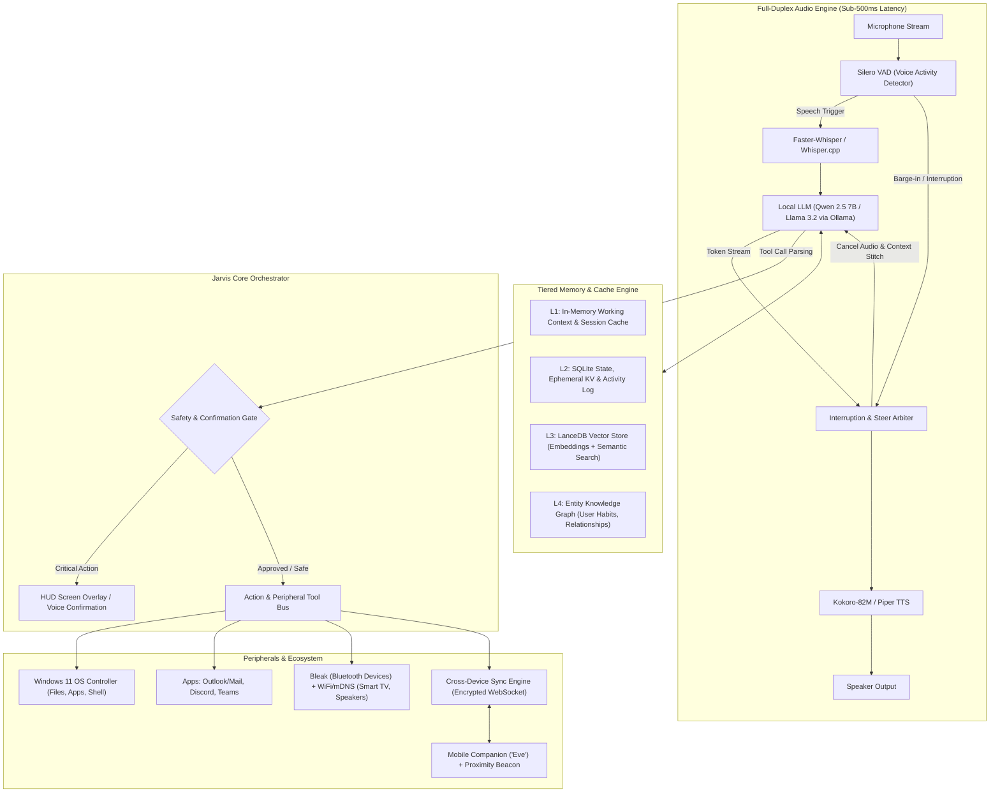
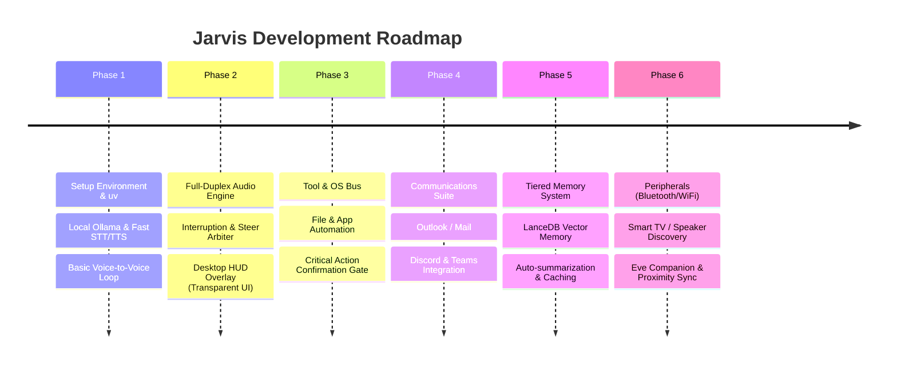

# Project JARVIS: Autonomous Local AI Assistant & Companion

An end-to-end architectural blueprint and implementation roadmap for building a private, real-time, low-latency, and interruptible AI assistant inspired by Iron Man's J.A.R.V.I.S., engineered specifically for Windows 11 with mobile handoff to **Eve**.

---

## 1. System Architecture Overview

---

## 2. Hardware Resource Budget (Target: RTX 4050 6GB VRAM + 16GB RAM)

Running a real-time multimodal voice assistant locally requires strict VRAM and CPU thread budgeting so your system remains responsive:

| Component | Recommended Engine | Footprint | Target Latency | Running On |
| :--- | :--- | :--- | :--- | :--- |
| **Voice Activity Detection (VAD)** | Silero VAD v5 (ONNX) | ~15 MB RAM | < 10 ms | CPU (1 thread) |
| **Speech-to-Text (STT)** | Faster-Whisper (`small.en` or `distil-whisper`) | ~400 MB VRAM / RAM | ~150–250 ms | CUDA / CPU |
| **Core Brain (LLM)** | Qwen 2.5 7B-Instruct (Q4_K_M) or Llama 3.2 3B | ~3.8 GB VRAM | ~30–45 tok/s | RTX 4050 (Ollama) |
| **Text-to-Speech (TTS)** | Kokoro-82M or Piper TTS | ~300 MB RAM | ~80 ms to first audio byte | CPU / CUDA |
| **Vector Memory** | LanceDB / SQLite-vec with MiniLM-L6 | ~150 MB RAM | < 15 ms retrieval | CPU |
| **HUD Overlay UI** | Tauri / Web-based Frameless Transparent Window | ~100 MB RAM | 60 FPS | Integrated/dGPU |
| **Total Headroom** | **~4.2 GB VRAM / ~4 GB RAM utilized**, leaving safe headroom for Windows and user apps. | | | |

---

## 3. Core Architectural Modules

### 3.1. The Full-Duplex Audio & "Steer" Engine
Jarvis must feel alive. The key to the Iron Man experience is **interruptibility** (barge-in) and **conversational steering**:
- **Continuous Circular Buffer**: The microphone continuously writes into a short audio ring buffer.
- **Barge-in Detection**: If the user speaks while Jarvis is generating or speaking:
  1. The audio output stream is immediately paused/muted.
  2. The LLM generation stream is cancelled.
  3. The arbiter records what portion of Jarvis's answer had already been spoken (`completed_speech_tokens`) and what was cut off (`interrupted_tokens`).
- **Context Stitching ("Steer")**:
  - The newly transcribed user prompt is merged with the interrupted thought:
    > *"Context: Jarvis was saying '[...spoken thoughts...]' before being interrupted with: '[New User Input]'. Continue naturally: acknowledge the new steer, wrap up any essential missing detail if still relevant, and address the new request directly."*

### 3.2. Tiered Memory & Context Architecture
Jarvis cannot afford to forget, nor can it afford to re-read everything into the prompt:
1. **L1 Working Cache**: In-memory ring buffer holding recent turn dialogues, active tool execution results, and ongoing tasks.
2. **L2 Relational State Store (SQLite)**: Stores contact books, calendar events, device registries, and permission rules.
3. **L3 Semantic Memory (LanceDB / Vector DB)**: Embedded chunks of long-term conversations, user preferences, project summaries, and code snippets with hybrid search (BM25 + cosine similarity).
4. **L4 Daily Log Summarizer**: Background daemon that runs during idle time or overnight to condense the day's conversations into concise episodic summaries.

### 3.3. Safety & Human-in-the-Loop Gate
Autonomous PC access must be powerful yet strictly safe:
- **Action Levels**:
  - **Level 0 (Read-Only / Ambient)**: Read time, check weather, search files, inspect battery status $\rightarrow$ Executed silently.
  - **Level 1 (Non-Destructive Local Action)**: Open an application, switch window, adjust volume $\rightarrow$ Executed with subtle HUD chime.
  - **Level 2 (Critical / Outgoing / Destructive)**: Send email, post Discord/Teams message, delete/overwrite files, run terminal commands $\rightarrow$ **Mandatory Confirmation**:
    - Jarvis presents a crisp visual preview card on the desktop HUD.
    - Jarvis offers voice readout: *"I have drafted the email to Sarah regarding the roadmap update. Would you like me to send it, or modify anything?"*
    - Waits for voice ("Send it", "Change subject to...") or keyboard click before executing.

### 3.4. System, Apps & Peripheral Control Bus
- **Windows OS**: Windows API / PowerShell bridge (`pywin32`, `uiautomation`) for active window management, file operations, audio control, process management.
- **Communications**:
  - **Discord**: Discord bot / local RPC for channel monitoring and messaging.
  - **Microsoft Teams**: Webhook integration or Graph API / local desktop automation.
  - **Email**: Direct IMAP/SMTP integration or local Outlook MAPI client.
- **Bluetooth & WiFi Peripherals**:
  - `bleak` for scanning, pairing, and connecting to Bluetooth speakers, headsets, and peripherals.
  - mDNS / SSDP discovery for smart home devices (Samsung/LG Smart TV, Chromecast, home media receivers).

### 3.5. Mobile Companion ("Eve") & Proximity Continuity
- **Companion Persona**: "Eve" runs on your phone as a lightweight client or PWA connected to the home server or local relay.
- **Shared Memory Sync**: High-priority tasks, reminders, and thoughts logged on Eve are synced over encrypted peer-to-peer connection (Tailscale / local WebSocket).
- **Proximity Handshake**:
  - When your phone enters the laptop's Bluetooth beacon radius or connects to the same home Wi-Fi:
  - Jarvis detects the presence:
    > *"Good afternoon, sir. I see you've returned. Eve noted that you scheduled a review for 3:00 PM and flagged two urgent emails. Shall I bring them up on your display?"*

---

## 4. Phased Implementation Roadmap

### Phase 1: The Core Voice-to-Voice Loop (MVP)
- Set up isolated Python 3.11/3.12 environment using `uv`.
- Integrate `Faster-Whisper` for audio capture + `Ollama` (Qwen 2.5 7B or Llama 3.2) + `Piper`/`Kokoro` for speech output.
- Validate end-to-end voice latency (< 1.2s round-trip).

### Phase 2: Duplex Audio, Interruptibility & HUD Overlay
- Implement `Silero VAD` continuous audio streamer with barge-in detection.
- Build the **Steer Arbiter** to resume and stitch interrupted thoughts.
- Create a sleek, Iron Man-inspired desktop HUD overlay (using Python/Tauri or lightweight web view) with floating audio visualizer and confirmation cards.

### Phase 3: System Automation & Safety Gate
- Implement the Tool Execution Bus with strict schema-based tool calling.
- Windows file system search, app launching, shell command executor.
- Safety Confirmation Gate: interactive confirmation UI for any Level 2 action.

### Phase 4: Apps & Mail Integration
- Local IMAP/SMTP and Outlook client connector with preview cards.
- Discord & Teams notification listener and message sender.

### Phase 5: Long-Term Memory & Optimization
- LanceDB vector store for conversational and semantic recall.
- In-memory key-value cache for instantaneous repeated queries (time, statuses, active states).
- Nightly background compaction agent for episodic memory.

### Phase 6: Hardware Peripherals & "Eve" Phone Companion
- Bluetooth scanner and connector (`bleak`).
- Smart TV / Media speaker controller (DLNA / UPnP).
- Mobile client (Eve) pairing with local server via secure LAN/Tailscale + proximity arrival detection.

---

## 5. Technology Stack Summary

| Layer | Recommended Technology |
| :--- | :--- |
| **Package & Env Manager** | `uv` (Ultra-fast Python 3.11/3.12 environment management) |
| **Local LLM Engine** | Ollama (Qwen 2.5 7B-Instruct / Llama 3.2 3B) via CUDA |
| **Audio Processing** | PyAudio / SoundDevice + Silero VAD v5 |
| **Speech-to-Text** | `faster-whisper` (CUDA accelerated) |
| **Text-to-Speech** | `kokoro-onnx` or `piper-tts` (near-instant synthesis) |
| **Vector Database** | `lancedb` (embedded, zero-config, ultra-fast disk/RAM vector search) |
| **Relational & Cache** | `sqlite3` + in-memory cache |
| **OS Automation** | `pywin32`, `pyautogui`, `psutil`, PowerShell API |
| **Peripheral Control** | `bleak` (Bluetooth Low Energy), `zeroconf` (mDNS / UPnP) |
| **Desktop HUD** | Modern Glassmorphism Overlay (Web-tech / Eel / PyWebView) |
