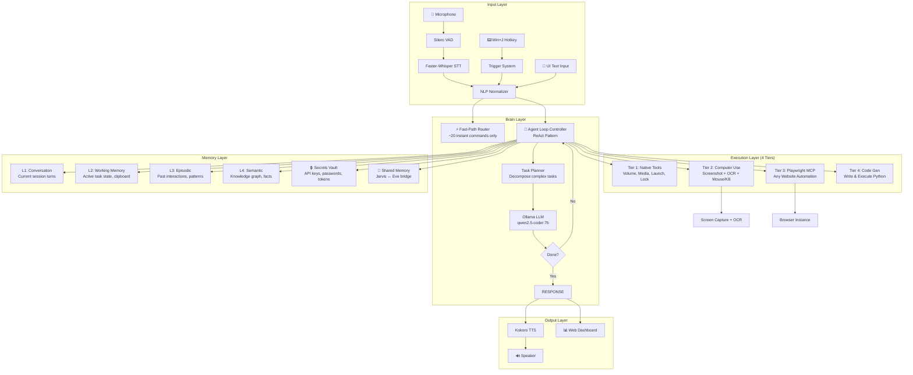

# J.A.R.V.I.S. — Complete Architecture Blueprint & Gap Analysis

> **"If I were building Jarvis from scratch to be the best AI agent possible, this is everything it would need."**

---

## 🔴 Honest Gap Analysis: What's Actually Broken/Missing

### Critical Gaps (Without these, Jarvis can't be a real agent)

| # | Gap | Current State | What It Should Be |
|---|-----|---------------|-------------------|
| 1 | **No Agentic Loop** | Single-shot: User → 1 LLM call → 1 tool → response | Multi-step: User → LLM plans → tool → observe → decide → loop until DONE |
| 2 | **MCP is Dead** | Config file exists but MCP servers are NEVER started or called | Real MCP client that spawns servers, discovers tools, and calls them at runtime |
| 3 | **Regex-First Intent** | 400+ lines of regex patterns in `router.py` trying to match every possible phrase | LLM-first intent understanding (like ChatGPT), with fast-path ONLY for 10 most common instant commands |
| 4 | **No Computer Use** | Can't interact with any local app unless there's a hardcoded tool | Screenshot + OCR + mouse/keyboard = control ANY application without writing tools |
| 5 | **No Real Memory** | Basic facts list in JSON | 4-layer memory architecture with episodic, semantic, working memory + secrets vault |
| 6 | **No Error Recovery** | If a tool fails, Jarvis just says "I encountered an error" | Self-healing: retry, try alternative approach, ask user for help |
| 7 | **No Task Decomposition** | Can only do 1-step tasks | Complex tasks broken into sub-steps with dependency tracking |
| 8 | **No Security/Secrets** | No credential storage at all | Encrypted vault for API keys, passwords, tokens |
| 9 | **No UI** | Terminal-only | Web dashboard with status, history, settings, voice waveform |
| 10 | **No Shared Memory** | Jarvis and Eve are separate | Shared knowledge graph both agents can read/write |

---

## 🧠 The Tool Explosion Problem (Critical Insight)

> **You asked: "Do we need detailed tools for every local and web application?"**
> 
> **Answer: NO. That path leads to 10,000 tools and is unmaintainable.**

### The Modern AI Agent Approach: 4-Tier Execution Model

Instead of writing tools for every app, you use **layers of abstraction**:

```
┌─────────────────────────────────────────────────────────────┐
│                    USER VOICE COMMAND                        │
├─────────────────────────────────────────────────────────────┤
│                                                             │
│  Tier 1: NATIVE TOOLS (< 1ms, hardcoded)                   │
│  ├── Volume, media controls, lock PC, launch app            │
│  ├── ONLY the top ~20 most-used instant actions              │
│  └── These bypass the LLM entirely for speed                │
│                                                             │
│  Tier 2: COMPUTER USE (screenshot + mouse + keyboard)       │
│  ├── Control ANY local application without writing tools    │
│  ├── "Delete that folder in VS Code" → screenshot VS Code,  │
│  │    find the folder visually, right-click, delete          │
│  ├── "Change graphics settings" → open Settings, navigate   │
│  └── Works for Blender, Discord, Photoshop, ANYTHING        │
│                                                             │
│  Tier 3: BROWSER AUTOMATION (Playwright MCP)                │
│  ├── Control ANY website without writing per-site tools     │
│  ├── "Schedule a meeting on Google Calendar" → navigate,    │
│  │    fill form, click create                                │
│  ├── "Reply to that email" → Gmail, find email, compose     │
│  ├── "Check my GitHub PRs" → navigate, read, summarize      │
│  └── Loops until task is confirmed done via screenshots     │
│                                                             │
│  Tier 4: CODE GENERATION & EXECUTION                        │
│  ├── For truly novel tasks, generate Python and run it       │
│  ├── "Write a script to rename all .jpg files"              │
│  ├── "Create a FastAPI server with auth"                     │
│  └── Self-tests the generated code before confirming        │
│                                                             │
├─────────────────────────────────────────────────────────────┤
│                  AGENTIC LOOP CONTROLLER                     │
│  Plan → Execute → Observe → Decide → Repeat until done      │
└─────────────────────────────────────────────────────────────┘
```

### What This Means Practically

| User Says | OLD Approach (tool per action) | NEW Approach (4-tier) |
|-----------|-------------------------------|----------------------|
| "Delete that folder in VS Code" | Need `vscode_delete_folder` tool | Computer Use: screenshot → find folder → right-click → delete |
| "Schedule meeting tomorrow at 3pm" | Need `google_calendar_create_event` tool | Playwright: open calendar → click → fill → save |
| "Reply to John's email with 'sounds good'" | Need `gmail_reply` tool | Playwright: open Gmail → find email → click reply → type → send |
| "Change my desktop wallpaper" | Need `set_wallpaper` tool | Computer Use: open Settings → Personalization → Background → browse |
| "Open Photoshop and create a 1920x1080 canvas" | Need `photoshop_new_canvas` tool | Computer Use: launch Photoshop → File → New → set dimensions |
| "Write a sorting algorithm in VS Code" | Need `vscode_write_code` tool | Computer Use: focus VS Code → new file → type code via keyboard |

> **You only need ~20 native tools. Everything else is handled by Computer Use + Playwright + Code Generation.**

---

## 🏗️ Complete Target Architecture



---

## 📋 Complete Tool Registry (What Jarvis SHOULD Have)

### Tier 1: Native Fast-Path Tools (Instant, No LLM)

These are the ONLY tools that bypass the LLM for speed:

| Category | Tool | Description |
|----------|------|-------------|
| **Audio** | `set_volume(percent)` | Set master volume |
| **Audio** | `change_volume_relative(delta)` | Increase/decrease volume |
| **Audio** | `mute_volume()` / `unmute_volume()` | Toggle mute |
| **Audio** | `get_volume()` | Check current volume |
| **Media** | `media_play_pause()` | Toggle playback |
| **Media** | `media_next_track()` / `media_prev_track()` | Skip tracks |
| **Power** | `lock_workstation()` | Lock PC |
| **Power** | `sleep_pc()` | Sleep mode |
| **Power** | `shutdown_pc()` / `restart_pc()` | ⚠️ With confirmation |
| **Window** | `show_desktop()` | Minimize all |
| **Process** | `launch_application(name)` | Open any app |
| **Process** | `kill_process(name)` | Close any app |
| **System** | `get_hardware_metrics()` | CPU/GPU/RAM/Battery |
| **System** | `get_current_active_window()` | What app am I in? |
| **System** | `list_active_apps()` | What's running? |
| **Clipboard** | `get_clipboard()` / `set_clipboard(text)` | Clipboard access |
| **Network** | `get_network_info()` | IP, WiFi status |

### Tier 2: Computer Use Tools (LLM-Driven, Any App)

| Tool | Description |
|------|-------------|
| `screenshot()` | Capture current screen as image |
| `screenshot_region(x, y, w, h)` | Capture specific region |
| `ocr_screen()` | Extract all text from screen |
| `find_element_on_screen(description)` | Use vision to find UI element by description |
| `mouse_click(x, y)` | Click at coordinates |
| `mouse_double_click(x, y)` | Double-click |
| `mouse_right_click(x, y)` | Right-click (context menu) |
| `mouse_drag(x1, y1, x2, y2)` | Drag and drop |
| `keyboard_type(text)` | Type text via keyboard |
| `keyboard_hotkey(keys)` | Press key combination (Ctrl+S, Alt+F4, etc.) |
| `keyboard_press(key)` | Press single key |
| `scroll(direction, amount)` | Scroll up/down/left/right |
| `wait_for_element(description, timeout)` | Wait until UI element appears |

> **With just these 13 tools, Jarvis can control EVERY application on your PC.**

### Tier 3: Browser Automation Tools (via Playwright MCP)

| Tool | Description |
|------|-------------|
| `browser_navigate(url)` | Go to URL |
| `browser_click(selector_or_text)` | Click element by CSS selector or visible text |
| `browser_type(selector, text)` | Type into input field |
| `browser_screenshot()` | Capture browser page |
| `browser_get_text(selector)` | Read text from page |
| `browser_scroll(direction)` | Scroll page |
| `browser_wait(selector, timeout)` | Wait for element |
| `browser_select(selector, value)` | Select dropdown option |
| `browser_back()` / `browser_forward()` | Navigation |
| `browser_new_tab(url)` | Open new tab |
| `browser_close_tab()` | Close current tab |
| `browser_list_tabs()` | List all open tabs |
| `browser_switch_tab(index)` | Switch to tab |
| `browser_get_page_content()` | Get full page text/DOM |

> **With these + agentic looping, Jarvis can automate ANY website: Gmail, Calendar, Teams, YouTube, GitHub, Amazon, banking, etc.**

### Tier 4: Code Generation & Execution Tools

| Tool | Description |
|------|-------------|
| `execute_python(code)` | Run Python code safely in sandbox |
| `execute_shell(command)` | Run shell command with safety guards |
| `write_code_to_file(path, code, language)` | Write generated code to file |
| `read_file(path)` | Read file contents |
| `write_file(path, content)` | Write/append to file |
| `create_directory(path)` | Create folder |
| `delete_directory(path)` | Delete folder recursively |
| `delete_file(path)` | Delete file |
| `rename_path(old, new)` | Rename file/folder |
| `move_path(source, dest)` | Move file/folder |
| `copy_path(source, dest)` | Copy file/folder |
| `search_files(query, path)` | Search filesystem |
| `list_directory(path)` | List folder contents |
| `git_status()` | Git repo status |
| `git_commit(message)` | Stage all and commit |
| `git_push()` | Push to remote |
| `git_pull()` | Pull from remote |
| `npm_run(script)` | Run npm script |
| `pip_install(package)` | Install Python package |

### Memory & Intelligence Tools

| Tool | Description |
|------|-------------|
| `save_memory(key, value, category)` | Store fact/preference/knowledge |
| `recall_memory(query)` | Semantic search through memories |
| `save_secret(name, value)` | Store encrypted credential |
| `get_secret(name)` | Retrieve credential |
| `save_episodic(event, outcome)` | Record what happened and what worked |
| `search_episodic(query)` | Search past experiences |
| `get_user_profile()` | Get all known user facts |
| `update_user_profile(key, value)` | Update user preferences |

---

## 🧠 The Agentic Loop (The Single Most Important Missing Piece)

### Current Flow (Broken for Complex Tasks)
```
User: "Open VS Code, create a project folder, add index.html, and start a dev server"
Jarvis: *tries to do it all in 1 tool call* → fails or does step 1 only
```

### Correct Flow: ReAct Agent Loop
```
User: "Open VS Code, create a project folder, add index.html, and start a dev server"

Agent Loop Iteration 1:
  THINK: "I need to: 1) Open VS Code 2) Create folder 3) Create file 4) Start server"
  ACT: launch_application("vscode")
  OBSERVE: "VS Code opened successfully"

Agent Loop Iteration 2:
  THINK: "VS Code is open. Now create project folder."
  ACT: execute_shell("mkdir D:\Projects\my-project")
  OBSERVE: "Directory created"

Agent Loop Iteration 3:
  THINK: "Folder created. Now create index.html with boilerplate."
  ACT: write_code_to_file("D:\Projects\my-project\index.html", "<html>...</html>", "html")
  OBSERVE: "File created at D:\Projects\my-project\index.html"

Agent Loop Iteration 4:
  THINK: "Files ready. Open folder in VS Code and start server."
  ACT: execute_shell("code D:\Projects\my-project && cd D:\Projects\my-project && npx -y live-server")
  OBSERVE: "Dev server running on localhost:8080"

Agent Loop Iteration 5:
  THINK: "All 4 steps complete. Task is done."
  RESPOND: "Your project is set up, Sir. VS Code is open with the project folder, index.html is created, and the dev server is running on localhost:8080."
```

### Implementation: `jarvis/core/agent_loop.py`

```python
class AgentLoop:
    """
    ReAct-style agent loop that plans, executes, observes, and repeats.
    MAX_ITERATIONS prevents infinite loops.
    Each iteration: LLM decides next action → execute → observe result → decide if done.
    """
    MAX_ITERATIONS = 15
    
    async def run(self, user_request: str, context: dict) -> str:
        """Execute user request through iterative plan-act-observe loop."""
        observations = []
        
        for i in range(self.MAX_ITERATIONS):
            # 1. LLM decides next action (or final response)
            decision = await self.llm.decide(
                user_request=user_request,
                observations=observations,
                available_tools=self.registry.get_all_tools(),
                iteration=i
            )
            
            # 2. If LLM says "DONE", return the final response
            if decision.is_final_response:
                return decision.response_text
            
            # 3. Execute the chosen tool
            result = await self.registry.execute(
                decision.tool_name, **decision.tool_args
            )
            
            # 4. Record observation
            observations.append({
                "step": i + 1,
                "action": f"{decision.tool_name}({decision.tool_args})",
                "result": result,
                "reasoning": decision.reasoning
            })
        
        return "I've reached the maximum number of steps. Here's what I accomplished so far..."
```

---

## 🔒 Memory Architecture (Complete)

### Layer 1: Conversation Memory (Exists, Needs Enhancement)
```
- Current session turns (user + assistant messages)
- Enhanced: Track which tools were called and their results
- Enhanced: Sliding window with summarization of older turns
```

### Layer 2: Working Memory (NEW)
```
- Active task state (what am I doing right now?)
- Clipboard contents
- Current screen context (last screenshot OCR)
- Active application and window context
- Pending sub-tasks in multi-step operations
```

### Layer 3: Episodic Memory (NEW)
```
- "Last time user asked to deploy, I used npm run build then scp"
- "User prefers dark mode in VS Code"
- "User's VS Code workspace is usually at D:\Projects"
- "When user says 'push it', they mean git push"
- Stores: (trigger, action_taken, outcome, timestamp)
- Used for: learning from past interactions
```

### Layer 4: Semantic Knowledge Graph (NEW)
```
- User profile: name, preferences, habits, schedule
- Relationships: "Om works on Jarvis project", "Eve is Jarvis's sister AI"
- Technical knowledge: "Project uses Ollama, Kokoro TTS, Faster-Whisper"
- World knowledge: project structures, API patterns
```

### Secrets Vault (NEW)
```
- Encrypted storage using DPAPI (Windows native) or age encryption
- Stores: GitHub tokens, API keys, email passwords, cloud credentials
- Access: Only through authenticated voice or explicit tool call
- Auto-discovery: Scan browser saved passwords (with permission)
```

### Shared Memory Bus (NEW — Jarvis ↔ Eve)
```
- SQLite or Redis-based shared knowledge store
- Both agents can read/write
- Event system: "Eve completed task X" → Jarvis gets notified
- Shared user profile and preferences
```

---

## 🌐 Global Rules Engine (Complete Set)

### Universal Rules (Apply to ALL tools and ALL apps)

| # | Rule | Implementation |
|---|------|----------------|
| 1 | **Open if closed** | Before any app-specific action, check if app is running. If not, launch it and wait for window to appear |
| 2 | **Reuse existing instances** | Always focus existing window. NEVER spawn duplicates unless user says "new window/instance" |
| 3 | **Close on command** | Map common names to process names. Kill gracefully first (WM_CLOSE), force kill only if needed |
| 4 | **Tab reuse in browsers** | Navigate in active tab. Only open new tab if user says "new tab" |
| 5 | **Workspace awareness** | Know the active VS Code workspace, browser tabs, active directory |
| 6 | **Confirm destructive actions** | Deleting files, closing unsaved work, shutdown → ask "Are you sure?" |
| 7 | **Undo support** | For file operations, move to recycle bin instead of permanent delete |
| 8 | **Rate limiting** | Don't spam-click or send rapid commands. Add reasonable delays between UI actions |
| 9 | **Fallback chain** | Native tool → Computer Use → Playwright → Code Gen → Ask user |
| 10 | **Error recovery** | On failure: retry once → try alternative method → report to user with what went wrong |
| 11 | **Context persistence** | Remember what you just did. "Do the same thing" = repeat last action |
| 12 | **Implicit context** | "Delete it" = delete whatever was just created/mentioned. "Open it" = open whatever was just discussed |
| 13 | **Batch operations** | "Create 5 test files" = loop and create all 5, not just 1 |
| 14 | **Progress reporting** | For multi-step tasks, speak brief progress: "Step 2 of 4 complete" |
| 15 | **Permission escalation** | For admin operations, explain what's needed and ask for consent |
| 16 | **Time awareness** | "Remind me in 10 minutes" = set timer. "Do this every morning" = schedule |
| 17 | **App-specific shortcuts** | Know that Ctrl+S saves, Ctrl+Z undoes, Ctrl+Shift+P opens command palette in VS Code, etc. |
| 18 | **Natural language paths** | "My downloads folder" = `C:\Users\ombor\Downloads`. "Desktop" = `C:\Users\ombor\Desktop` |
| 19 | **Safe mode for risky ops** | Before running unknown shell commands, explain what they do |
| 20 | **Graceful degradation** | If GPU is busy, fall back to CPU. If Ollama is slow, queue and notify |

---

## 🗺️ Implementation Roadmap (Priority-Ordered)

### Phase 1: Foundation Fixes (This Week) ← **START HERE**
> Make existing features actually work reliably

- [ ] **Fix `kill_process`** — proper process name mapping
- [ ] **Fix app launching** — no more duplicate instances ever
- [ ] **Add `delete_directory`** — the missing tool
- [ ] **Fix router** — reduce regex, let more flow to LLM
- [ ] **Add global rules middleware** — `AppLifecycleManager`

### Phase 2: Agentic Loop (Next Week) ← **THE GAME CHANGER**
> This single change makes Jarvis 10x more capable

- [ ] **Implement `AgentLoop`** — ReAct pattern with observe-decide loop
- [ ] **Multi-step task execution** — compound commands actually work
- [ ] **Tool result observation** — LLM sees what happened and decides next step
- [ ] **Max iterations guard** — prevent infinite loops (cap at 15)
- [ ] **Progress reporting** — TTS speaks progress for multi-step tasks

### Phase 3: Computer Use (Week 3) ← **CONTROL ANY APP**
> Eliminates the need for per-app tools for local applications

- [ ] **Screen capture + OCR** — already partially built (`ScreenTool`)
- [ ] **UI element detection** — find buttons, text fields, menus by description
- [ ] **Mouse/keyboard automation** — `pyautogui` already imported, formalize it
- [ ] **Visual grounding** — "click the blue button" → find blue button in screenshot → click
- [ ] **Window-specific screenshots** — capture just one app, not full desktop

### Phase 4: Real MCP Runtime (Week 4) ← **BROWSER AUTOMATION**
> Make Playwright MCP actually work for any website

- [ ] **MCP stdio client** — start MCP servers as child processes, communicate via stdin/stdout
- [ ] **Playwright integration** — browser automation for ANY website
- [ ] **Tool discovery** — dynamically discover and register MCP tools at runtime
- [ ] **Agentic browser loop** — navigate → screenshot → decide → act → loop until done
- [ ] **Session management** — keep browser sessions alive, handle login states

### Phase 5: Memory & Intelligence (Week 5-6)
> Jarvis remembers everything and learns

- [ ] **Episodic memory** — SQLite store for past interactions and outcomes
- [ ] **Semantic memory** — vector embeddings for knowledge search
- [ ] **Secrets vault** — encrypted credential storage with DPAPI
- [ ] **Working memory** — active task state, recent context
- [ ] **Shared memory bus** — Jarvis ↔ Eve shared SQLite store
- [ ] **Learning from corrections** — "No, I meant X" → save as episodic memory
- [ ] **Enhanced NLP** — context-aware accent correction using LLM

### Phase 6: UI & Polish (Week 7-8)
> Visual dashboard and user experience

- [ ] **Web dashboard** — Next.js/Vite app with WebSocket connection to Jarvis
- [ ] **Voice waveform visualization** — real-time audio display
- [ ] **Task history** — searchable log of all interactions
- [ ] **Settings panel** — configure wake word, voice, LLM model, etc.
- [ ] **Status indicators** — listening, processing, speaking, idle
- [ ] **Notification system** — desktop toasts for background tasks

---

## 📐 File Structure (Target)

```
jarvis/
├── core/
│   ├── pipeline.py          # Main orchestrator (exists)
│   ├── agent_loop.py        # NEW: ReAct agentic loop
│   ├── task_planner.py      # NEW: Decompose complex requests
│   ├── arbiter.py           # Barge-in handler (exists)
│   ├── config.py            # Config loader (exists)
│   ├── memory.py            # Refactor: L1-L4 memory layers
│   └── rules_engine.py      # NEW: Global rules enforcement
│
├── brain/
│   ├── ollama_client.py     # LLM client (exists)
│   ├── intent_resolver.py   # NEW: LLM-based intent understanding
│   └── prompt_templates.py  # NEW: Centralized prompt engineering
│
├── tools/
│   ├── registry.py          # Tool registry (exists)
│   ├── router.py            # Fast-path only, MUCH smaller (refactor)
│   ├── computer_use.py      # NEW: Screenshot + OCR + Mouse/KB
│   ├── code_executor.py     # NEW: Safe Python/shell execution
│   ├── os_control.py        # Volume, media, power (exists)
│   ├── process_control.py   # Launch, kill apps (exists, fix)
│   ├── file_control.py      # File/folder CRUD (exists, enhance)
│   ├── web_control.py       # Browser shortcuts (exists, simplify)
│   ├── git_tools.py         # NEW: Git operations
│   ├── mcp_bridge.py        # Refactor: Real MCP runtime client
│   └── plugins/             # Auto-discovered plugins (exists)
│
├── memory/
│   ├── conversation.py      # NEW: L1 conversation memory
│   ├── working.py           # NEW: L2 active task state
│   ├── episodic.py          # NEW: L3 past interactions
│   ├── semantic.py          # NEW: L4 knowledge graph
│   ├── secrets.py           # NEW: Encrypted credential vault
│   └── shared_bus.py        # NEW: Jarvis ↔ Eve bridge
│
├── audio/
│   ├── vad.py               # Voice activity detection (exists)
│   ├── stt.py               # Speech-to-text (exists)
│   ├── tts.py               # Text-to-speech (exists)
│   ├── mood.py              # Mood analysis (exists)
│   ├── trigger.py           # Wake word + hotkey (exists)
│   ├── speaker_id.py        # Voice authentication (exists)
│   └── accent_normalizer.py # Speech cleanup (exists)
│
├── ui/
│   ├── server.py            # NEW: WebSocket server for dashboard
│   ├── dashboard/           # NEW: Web UI (Vite + React)
│   └── notifications.py     # NEW: Desktop toast notifications
│
└── security/
    ├── sandbox.py           # NEW: Safe code execution sandbox
    ├── permission.py        # NEW: Permission escalation system
    └── audit.py             # NEW: Action audit logging
```

---

## 🎯 Key Architectural Decisions

### 1. LLM-First, Not Regex-First
**Current**: 400 lines of regex in `router.py` trying to match phrases
**Target**: Only ~20 fast-path commands use regex. Everything else goes to the LLM.
**Why**: The LLM is MUCH better at understanding "make the laptop quieter" than any regex pattern.

### 2. Computer Use Over Per-App Tools
**Current**: Writing custom tools for VS Code, then would need tools for Blender, Photoshop, Discord...
**Target**: One `computer_use.py` that can control any app via screenshot + mouse + keyboard
**Why**: You can't write tools for 1000 apps. But you CAN screenshot any app and interact with it.

### 3. Playwright Over URL Manipulation
**Current**: Building URLs and pasting them into the address bar
**Target**: Real Playwright browser automation with DOM access
**Why**: You can fill forms, click buttons, read page content, handle logins — everything.

### 4. Agentic Loop Over Single-Shot
**Current**: One tool call per user request
**Target**: Loop until the task is actually done, with observation after each step
**Why**: Real tasks are multi-step. "Set up a new project" requires 5-10 actions.

### 5. Memory Layers Over Flat Facts
**Current**: List of string facts in a JSON file
**Target**: 4-layer memory with different storage, retrieval, and persistence characteristics
**Why**: "What's my name" (semantic) vs "What did I just say" (conversation) vs "How did we deploy last time" (episodic) need different storage.

---

## 💡 Quick Wins You Can Do Right Now

1. **Today**: Fix `kill_process` process name mapping and `delete_directory`
2. **Today**: Add computer_use.py with basic screenshot + click + type
3. **Tomorrow**: Implement basic `AgentLoop` with 3-step limit
4. **This week**: Get Playwright MCP actually running and calling tools
5. **This week**: Reduce `router.py` from 420 lines to ~100 lines (fast-path only)
